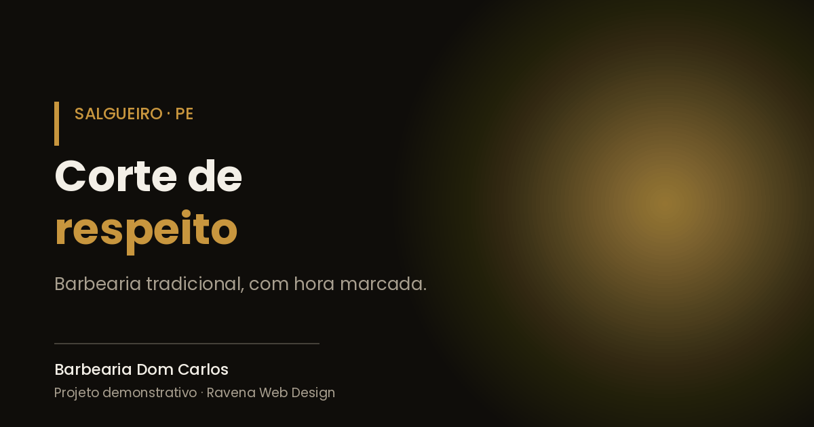

# Barbearia Dom Carlos

Site de página única para barbearia, com serviços, tabela de preços e agendamento direto pelo WhatsApp.

🔗 **[Ver no ar](https://ravena-web-design-oficial.netlify.app/demos/barbearia-dom-carlos)**

## Funcionalidades

- Layout responsivo (celular, tablet e desktop)
- Seção de serviços e tabela de preços
- Horários e localização
- Botão de agendamento que abre a conversa no WhatsApp
- Meta tags para SEO e compartilhamento em redes sociais

## Tecnologias

HTML5 · CSS3 · JavaScript

CSS escrito à mão, sem framework. Página única, sem dependências externas.

## Sobre o projeto

Projeto demonstrativo com negócio fictício, criado do zero: layout, código e deploy.
Faz parte do portfólio da [Ravena Web Design](https://ravena-web-design-oficial.netlify.app).

---

Feito por **Ravena Leite** · [LinkedIn](https://www.linkedin.com/in/ravena-leite-3a5804399/) · [GitHub](https://github.com/ravenaleite)
